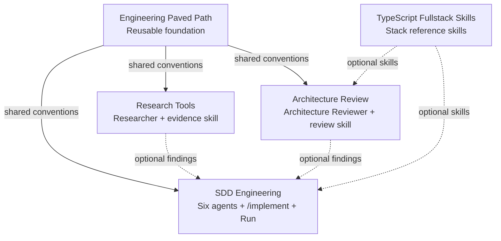
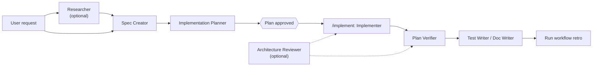

# Plugin ecosystem specification

## Purpose

The marketplace provides public, reusable Claude Code workflows. Components must work in any repository and must not depend on a specific organization, local directory, or private repository.

## Plugin boundaries

### Engineering Paved Path

Reusable foundation for repository-aware implementation work:

- `paved-path` skill for discovery, focused changes, and validation;
- `engineering-insights` skill for the per-module `INSIGHTS.md` protocol;
- shared conventions referenced by the other plugins.

### Research Tools

Research and evidence collection:

- `researcher` agent;
- `source-grounded-research` skill.

Composition dependency: uses Engineering Paved Path conventions when research findings become implementation input.

### Architecture Review

Architecture and boundary review:

- `architecture-reviewer` agent;
- `architecture-review` skill (review protocol);
- `onion-architecture` and `ui-architecture` rule packs;
- `pr-self-review` dispatcher skill.

Composition dependency: uses Engineering Paved Path conventions for repository discovery and evidence-backed validation.

### SDD Engineering

Specification-driven delivery:

- `spec-creator`, `implementation-planner`, `implementer`, `plan-verifier`, `test-writer` and `doc-writer` agents;
- `/implement` orchestrator command;
- a path-guard hook that limits where the spec, plan and documentation agents may write;
- `specification-driven-development` skill and `run` skill (workflow retrospective);
- workflow README and release notes.

Composition dependencies: consumes research and architecture findings when available, and uses Engineering Paved Path conventions for implementation and verification.

### TypeScript Fullstack Skills

Reference skills for a TypeScript stack: `zod`, `fastify-best-practices`, `drizzle-orm-patterns`, `postgresql-table-design`, `react-best-practices`, `react-testing-library`, `next-best-practices`, `typescript-expert`, `security`, `mermaid-diagram`.

Composition dependency: referenced by name from Architecture Review's `ui-architecture` pack and SDD Engineering's planner; never required.

## Dependency graph

Solid edges describe composition. For SDD Engineering the three solid edges are declared `dependencies` in `plugin.json` (`^1.0`), so installing it installs and enables Engineering Paved Path, Research Tools and Architecture Review; Claude Code resolves the ranges against `<plugin>--v<version>` tags. The other plugins remain independently installable with no dependencies. Dashed edges describe optional workflow hand-offs between installed plugins.

## Workflow

## Public path rules

- Use relative paths such as `src/`, `docs/`, and `tests/` only as examples.
- Never mention a local checkout path, a private organization, or a marketplace-specific directory in an agent or skill.
- Ask the user for the repository root when a workflow needs one.
- Use stable plugin/component names, not hard-coded absolute paths.
- Keep examples generic enough to work in JavaScript, TypeScript, Python, Go, or other repositories.

## Versioning and releases

Each plugin owns its version in `.claude-plugin/plugin.json`. Marketplace entries must keep names stable and should not duplicate a conflicting version. Releases use SemVer and immutable tags; rollback is a reviewed change from a known-good tag, not a rewritten tag.
