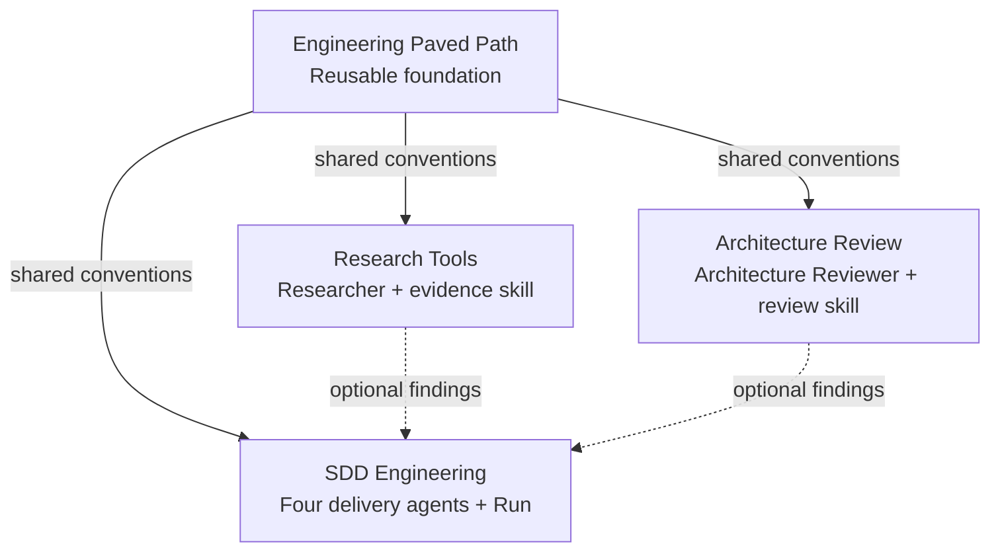
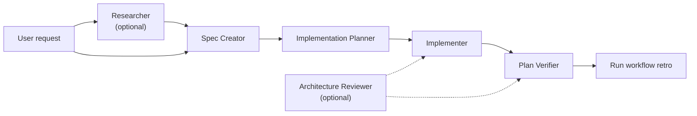

# Plugin ecosystem specification

## Purpose

The marketplace provides public, reusable Claude Code workflows. Components must work in any repository and must not depend on a specific organization, local directory, or private repository.

## Plugin boundaries

### Engineering Paved Path

Reusable foundation for repository-aware implementation work:

- `paved-path` skill for discovery, focused changes, and validation.
- shared conventions referenced by the other plugins.

### Research Tools

Research and evidence collection:

- `researcher` agent;
- `source-grounded-research` skill.

Composition dependency: uses Engineering Paved Path conventions when research findings become implementation input.

### Architecture Review

Architecture and boundary review:

- `architecture-reviewer` agent;
- `architecture-review` skill.

Composition dependency: uses Engineering Paved Path conventions for repository discovery and evidence-backed validation.

### SDD Engineering

Specification-driven delivery:

- `spec-creator` agent;
- `implementation-planner` agent;
- `implementer` agent;
- `plan-verifier` agent;
- `run` skill (workflow retrospective);
- workflow README and release notes.

Composition dependencies: consumes research and architecture findings when available, and uses Engineering Paved Path conventions for implementation and verification.

## Dependency graph

Solid edges describe documented composition. Dashed edges describe optional workflow hand-offs. These are not automatic install-time dependencies; every plugin remains independently installable.

## Workflow

## Public path rules

- Use relative paths such as `src/`, `docs/`, and `tests/` only as examples.
- Never mention a local checkout path, a private organization, or a marketplace-specific directory in an agent or skill.
- Ask the user for the repository root when a workflow needs one.
- Use stable plugin/component names, not hard-coded absolute paths.
- Keep examples generic enough to work in JavaScript, TypeScript, Python, Go, or other repositories.

## Versioning and releases

Each plugin owns its version in `.claude-plugin/plugin.json`. Marketplace entries must keep names stable and should not duplicate a conflicting version. Releases use SemVer and immutable tags; rollback is a reviewed change from a known-good tag, not a rewritten tag.
